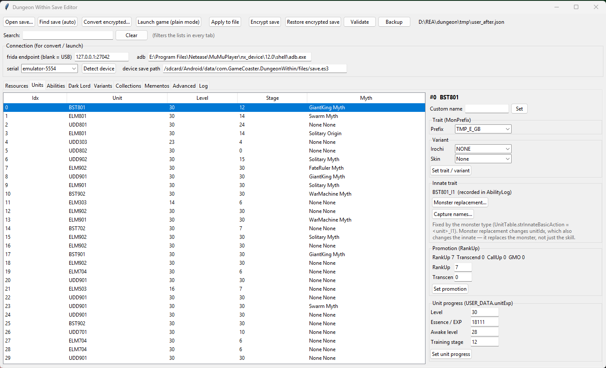
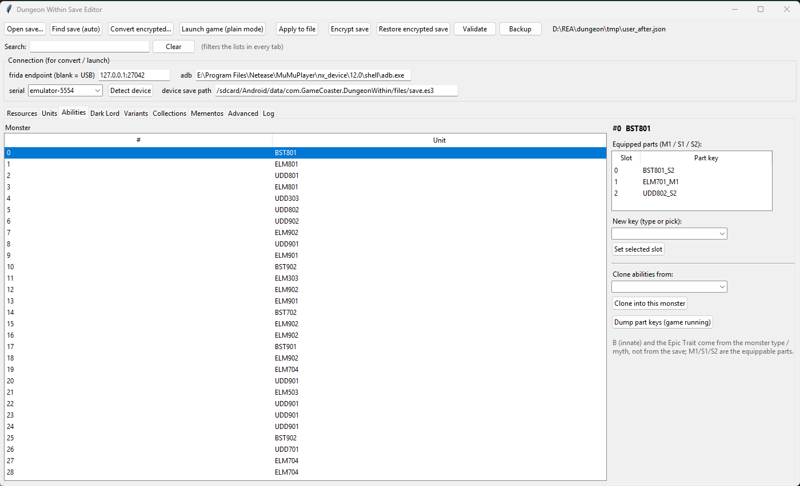
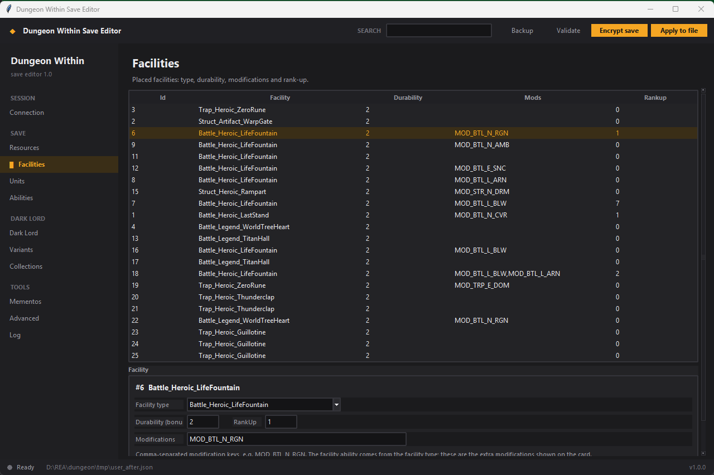

# Dungeon Within Save Editor — Android save editor for resources, monsters, facilities and the Dark Lord

Open-source **save editor for Dungeon Within** on Android (emulator or rooted phone).
Edit gold and resources, monster levels, stats and abilities, facility modifiers, Dark Lord
aspects and variants, then encrypt the save back with the game's own code so it loads like a
normal save. No AES key is shipped, no offsets are hardcoded, and every edit is checksum-validated.

[](https://github.com/Darktenebr01/DungeonWithinSaveEditor/releases/latest)
[](LICENSE)
[](#install-and-run)
[](#how-it-works)



## How it works

The save is an `ES3E` container encrypted by the game's own code. The editor does not
reimplement that crypto. Instead it attaches with Frida and:

1. starts the game and hooks `ES3Saver.DecryptAndDecompress`, capturing the plain JSON the
   game produced;
2. edits that JSON textually, touching only the scalar tokens it changes, so the ES3 dialect
   (and every unrelated byte) stays intact;
3. for writing back, fills the game's decrypted buffer with your JSON and calls the real
   `CompressAndEncrypt` on the game thread, then writes the ciphertext over `save.es3` with libc.

The two functions are found by name at runtime and cached per `<game version>:<abi>`, so there
are no hardcoded offsets. `adb` and the device are auto-detected; a networked Frida endpoint can
be entered by hand.

## What you can do

| Screen | What it does |
| --- | --- |
| **Resources** | Edit every `USER_DATA.storage` currency/resource (gold, essence, tokens), searchable |
| **Facilities** | Facility type, ability modifiers (bonus index that drives durability), modifications picked from a dropdown or typed as keys (`prefixs`), rank-up |
| **Units** | Level, essence/EXP, awake and training stage, base/grow stats, custom name, trait, variant (`Irochi`), skin, innate trait display, promotion (`RankUp`/`Transcend`), monster type replacement |
| **Abilities** | Equip `M1`/`S1`/`S2` parts from a 473-key catalog, clone a whole ability set from another monster |
| **Dark Lord** | Unlock the six forms, set level/tokens, aspect stage, per-ability authority stage, and the Dark Lord skin |
| **Variants** | Stored variant counts (`NONE`/`BETRAY`) and variant research levels |
| **Collections** | Collection counters used by codex and costume unlocks |
| **Mementos** | Memento buy counts |
| **Advanced** | Get/set any JSON path |
| **Log** | Everything the Frida side reports |

A search box at the top filters every list. **Apply to file** writes the local JSON,
**Encrypt save** turns it back into a normal `ES3E` save, **Validate** recomputes and checks all
413 DataVault checksums.





## Install and run

> Zero-install: the exe ships `adb.exe` and `frida-server` for x86_64/arm64. Enable root on the
device, click **Prepare device**, and the editor pushes and starts everything itself.

**Download:** the standalone Windows build is in
[Releases](https://github.com/Darktenebr01/DungeonWithinSaveEditor/releases/latest)
(`DungeonWithinSaveEditor.exe`, no Python needed).

From source — requirements: Windows 10/11, Python 3.10+, `adb` (Android platform-tools), and
a rooted device/emulator with `frida-server` running.

```bat
python -m pip install -r requirements.txt
run.bat
```

or manually:

```bat
python main.py
```

To build a standalone executable:

```bat
build.bat
```

The result is `dist\DungeonWithinSaveEditor.exe`.

## Safety

Every operation touches a real save, so the editor:

- writes a `.bak` next to the save before **Apply to file**;
- keeps a backup of the encrypted device save before **Launch game (plain mode)**;
- verifies the encrypted result by decrypting it again and comparing a marker value (`GOLD` by
  default), and pushes the previous save back if it differs;
- never leaves a plain JSON file on the device after encrypting, because a normal launch would
  then show “Device Data empty” and a cloud conflict.

Use it on single-player saves only, keep your own backups, and prefer **Encrypt save** over plain
mode. This is a fan tool; Dungeon Within belongs to its developers, and this project is not
affiliated with or endorsed by them.

## Frequently asked questions

### Is there a Dungeon Within save editor for Android?

Yes — this one. It runs on Windows and edits the Android save through `adb` and Frida, so it
works with emulators (MuMu, LDPlayer, BlueStacks) and rooted phones, on any ABI.

### How do I edit my Dungeon Within save?

Start the game once so the save exists, connect the device, press **Find save** to decrypt,
change values, then **Apply to file** and **Encrypt save**. The encrypted file is decrypted again
to verify it, and the previous save is restored if verification fails.

### Do I need the encryption key?

No. The game decrypts and encrypts the file itself; the editor only drives it.

### Does it work after a game update?

Usually. The crypto functions are located by name and offsets are cached per
`<version>:<abi>`; a new build needs one calibration run.

### Where is the save file?

`/sdcard/Android/data/com.GameCoaster.DungeonWithin/files/save.es3` (the editor probes this path
and updates it if the game changes it).

## Project layout

```
main.py                  entry point
version.py               version constants
tools/dw_save_gui.py     tkinter UI (all tabs)
tools/dw_theme.py        dark theme palette and ttk styles
tools/dw_save_editor.py  text-preserving JSON editor + checksums
tools/dw_save_convert.py decrypt: capture the plain save
tools/dw_save_encrypt.py encrypt: write the edited save back
tools/dw_save_launch.py  plain-save launcher (fallback mode)
tools/dw_android.py      adb / device / Frida discovery
tools/dw_methods.py      runtime method offsets, cached per build
tools/dw_names.py        capture monster names from the running game
tools/dw_dump_parts.py   dump live ability/part tables
tools/dw_capture_mawang.py  capture Dark Lord costume data
tools/parts_catalog.json part key catalog
tools/facility_catalog.json facility type catalog
tools/facility_prefixes.json modification key catalog
tools/dw_setup.py       prepare device: push and start bundled frida-server
vendor/                 bundled adb + frida-server (xz) and their licenses
docs/SAVE_EDITOR.md      save format, encryption flow, portability notes
docs/index.html          landing page (GitHub Pages)
tests/                   parser/checksum tests
```

## Development

```bat
python -m pip install -r requirements-dev.txt
python -m unittest discover -s tests -v
```

Design and format notes live in [docs/SAVE_EDITOR.md](docs/SAVE_EDITOR.md); release history in
[CHANGELOG.md](CHANGELOG.md).

## License

MIT — see [LICENSE](LICENSE).
